<div align="center">

# Free My TV

**A clean, Apple TV–style Home for a TCL Google TV — no ads, no clutter, fully under the owner's control.**

[](https://github.com/felipevgomes10/free-my-tv/releases/latest)


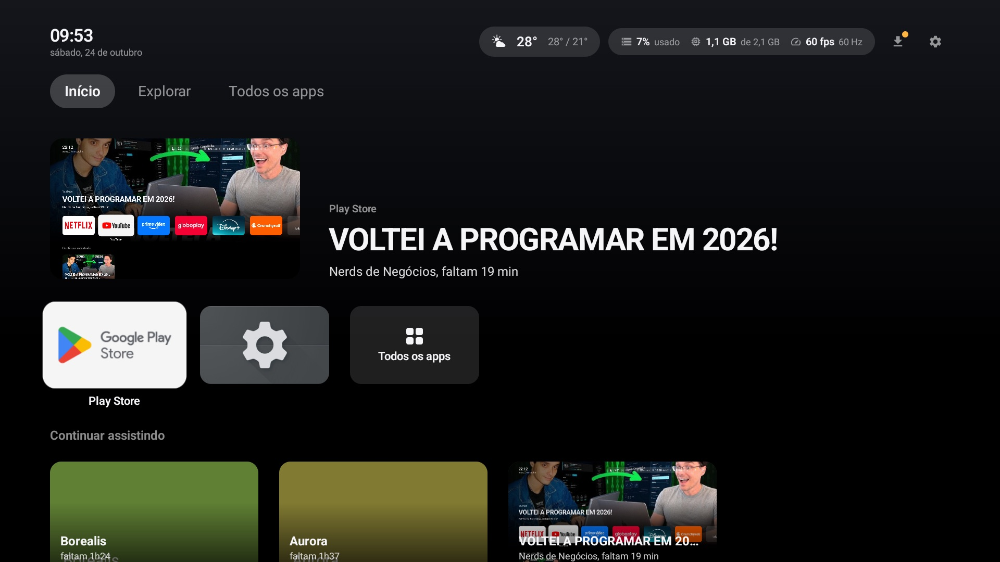

</div>

---

Google TV's launcher on a TCL set is a billboard: rows of sponsored content, apps you never installed, a remote full of buttons that open someone else's store. **Free My TV** replaces it with a Home in the spirit of Apple TV's: your apps, what you were watching, your inputs, and nothing else.

It is not a ROM and it doesn't root anything. It is an ordinary Android app that becomes the TV's Home, plus a Setup script that runs from your computer over ADB, shows its whole plan before touching anything, and can undo every change it made.

## Screenshots

<table>
  <tr>
    <td width="50%"><br><sub><b>Home</b> — the Top Shelf shows what you last watched in the focused app</sub></td>
    <td width="50%">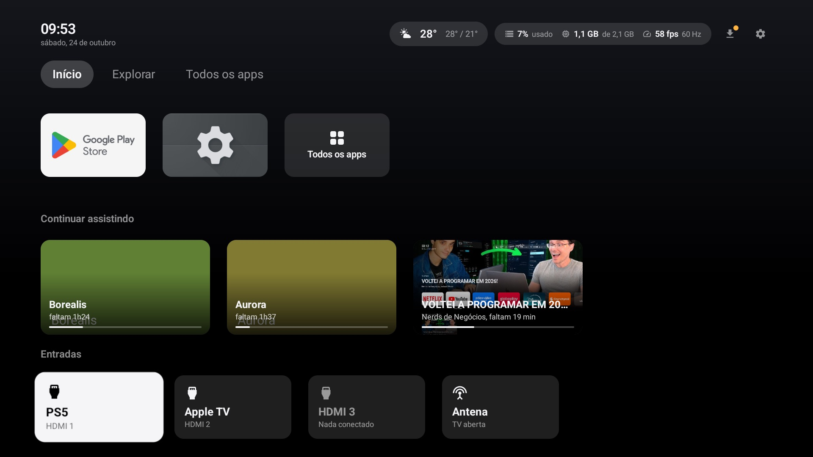<br><sub><b>Continuar assistindo</b> and <b>Entradas</b> — resume a video or jump to an HDMI input</sub></td>
  </tr>
  <tr>
    <td>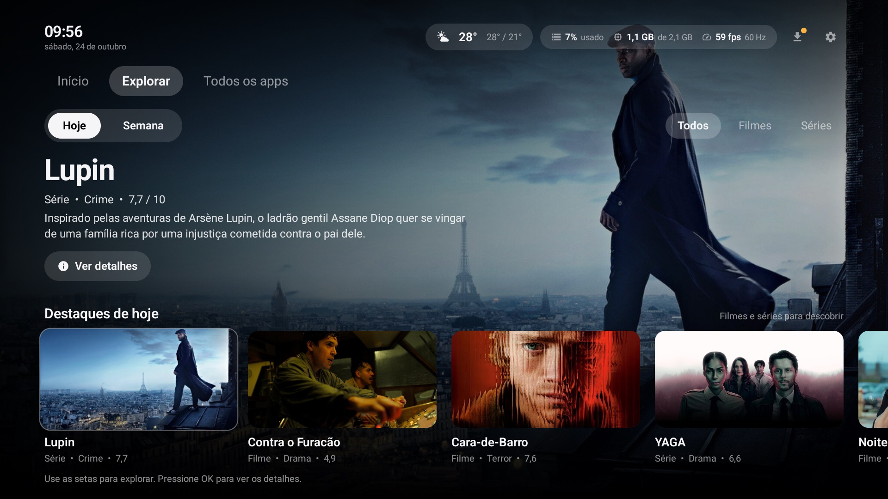<br><sub><b>Explorar</b> — today's and this week's trending movies and series, from TMDB</sub></td>
    <td>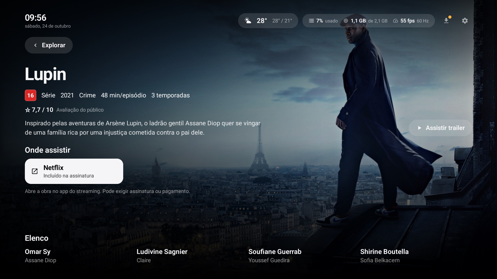<br><sub><b>A Title</b> — facts, cast, trailer, and where to watch it in Brazil</sub></td>
  </tr>
  <tr>
    <td>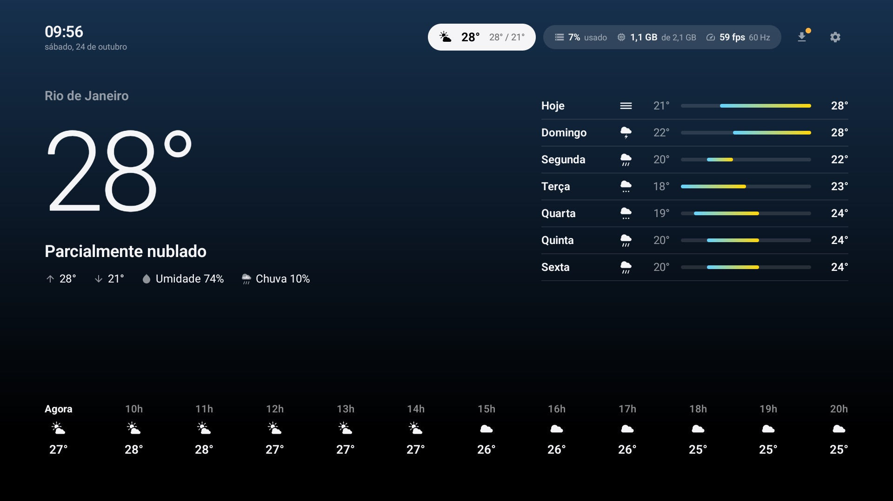<br><sub><b>Weather</b> — now, the next 12 hours and 7 days</sub></td>
    <td>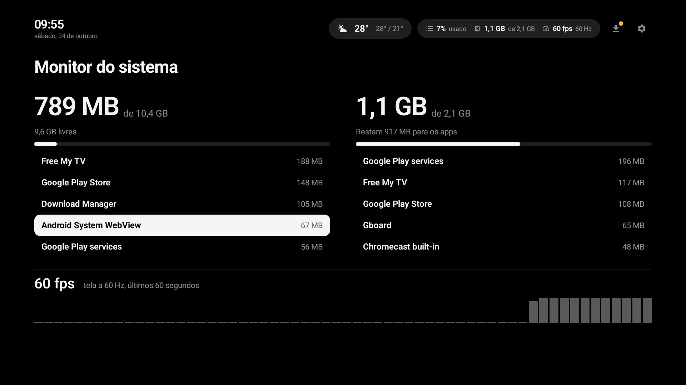<br><sub><b>System Monitor</b> — storage, memory, the apps behind them and the Home's frame rate</sub></td>
  </tr>
  <tr>
    <td>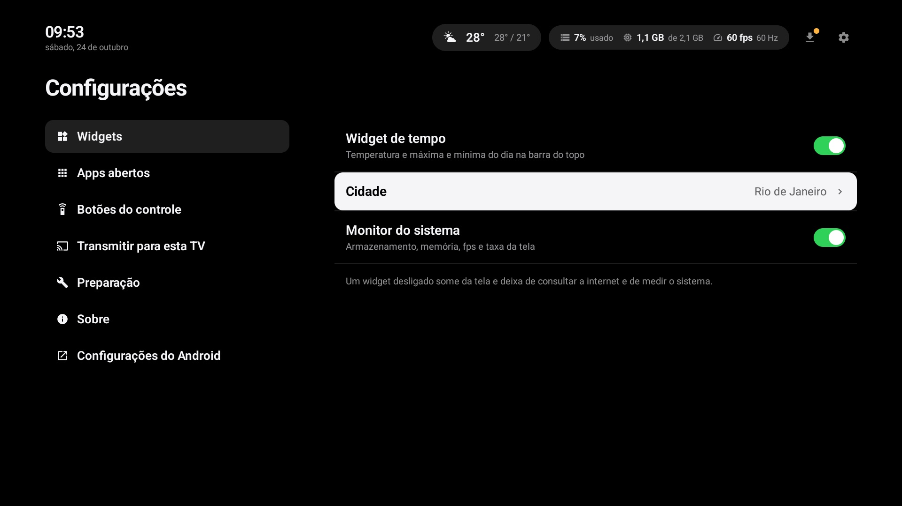<br><sub><b>Settings</b> — widgets, open apps, remote buttons, casting, Setup status</sub></td>
    <td>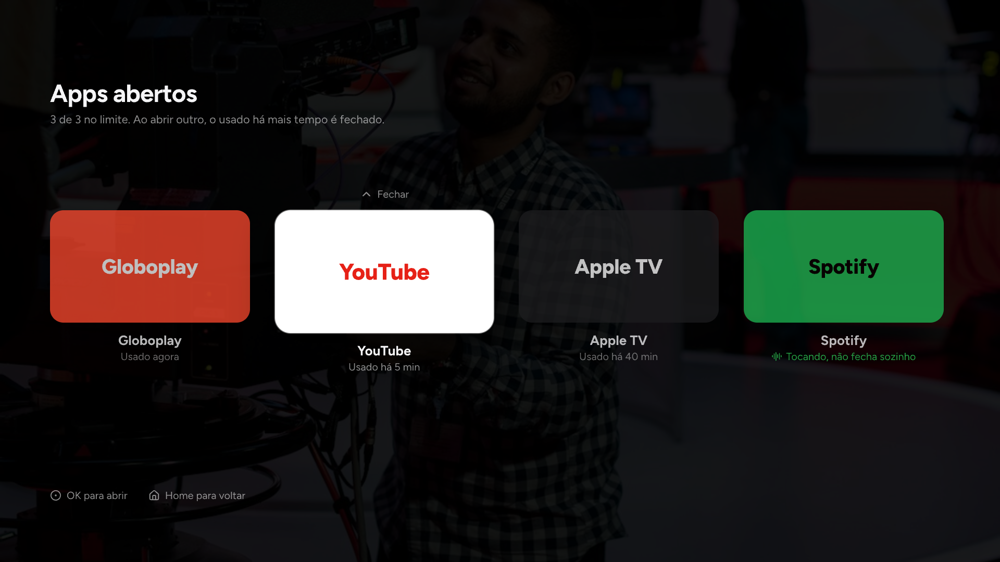<br><sub><b>App Switcher</b> (design) — press Home twice to switch or close apps</sub></td>
  </tr>
</table>

<details>
<summary><b>More screens, from the design file</b></summary>
<br>
<table>
  <tr>
    <td width="50%">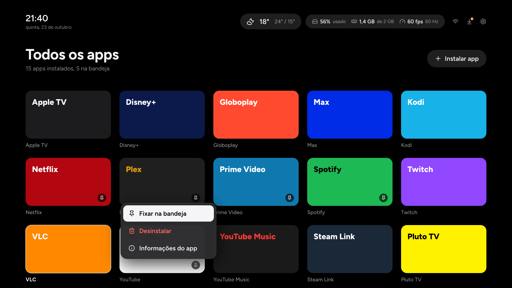<br><sub><b>Todos os apps</b> — pin, uninstall, install</sub></td>
    <td width="50%">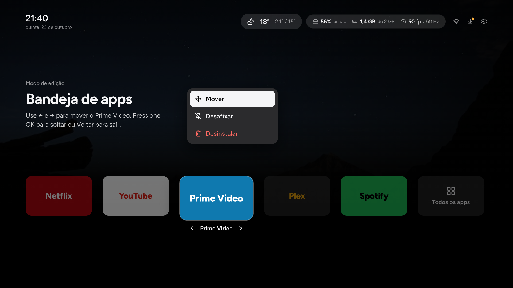<br><sub><b>Edit Mode</b> — hold OK to reorder the App Tray</sub></td>
  </tr>
  <tr>
    <td>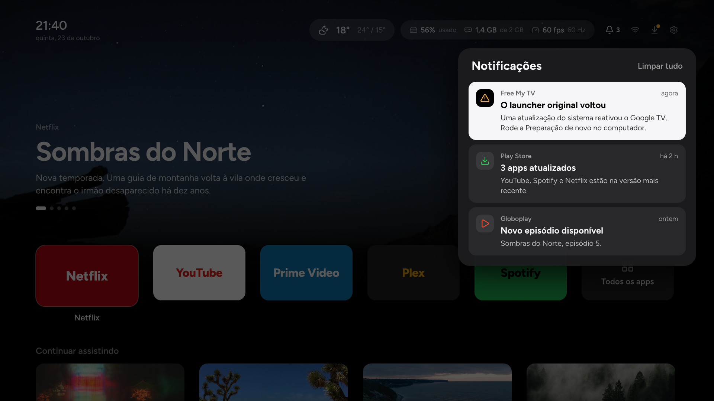<br><sub><b>Notification Panel</b></sub></td>
    <td>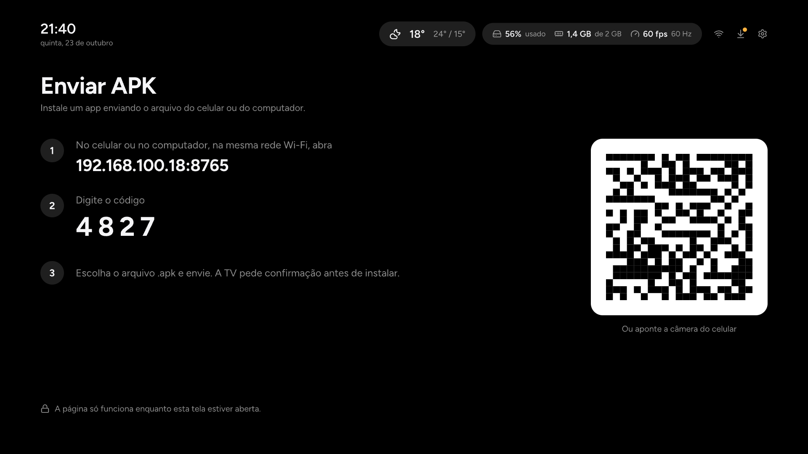<br><sub><b>Enviar APK</b> — install an app sent from your phone</sub></td>
  </tr>
  <tr>
    <td>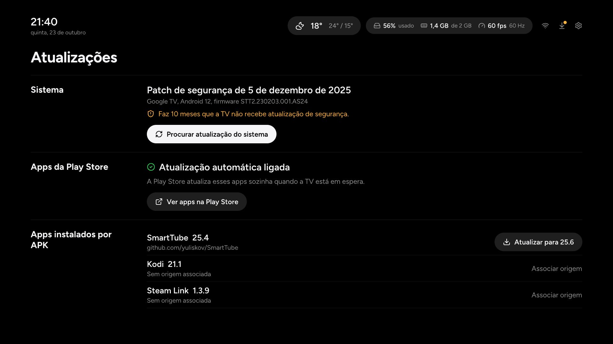<br><sub><b>Atualizações</b> — security patch, Play Store, and apps installed from APKs</sub></td>
    <td>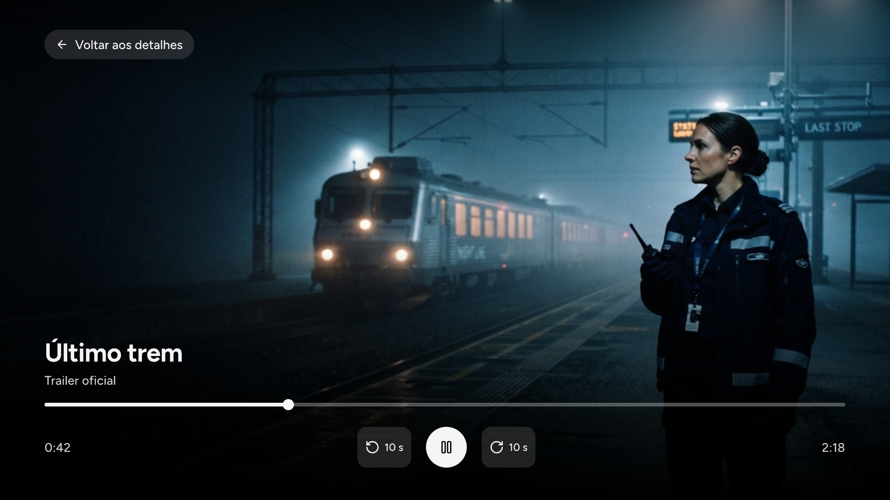<br><sub><b>Trailer</b> — played inside the Home with its own controls</sub></td>
  </tr>
</table>

Screenshots come from the Google TV emulator; the designs live in [`design.pen`](design.pen) and [`docs/design`](docs/design).
</details>

## What it does

**On the Home**
- **Top Shelf** — what you last watched in the app you're on, with its picture; several entries take turns, sliding.
- **App Tray** — only the apps you pinned, in your order. Hold OK to move, unpin or uninstall.
- **Continuar assistindo** — what was playing in any app, read from Android's media sessions, with how much is left; selecting it takes you back to it, YouTube videos included.
- **Entradas** — HDMI inputs and the antenna, renameable and hideable.
- **Status Bar widgets** — weather and a system monitor (storage, memory, frame rate), each opening its own detail screen. Weather's detail has full-screen weather footage and quiet ambient noise, with a mute button that remembers your choice; both stop when you leave.

**Explorar**
- Trending movies and series of the day or the week from [TMDB](https://www.themoviedb.org), filtered by movies or series.
- Each Title's facts, age rating, cast, and **where to watch it in Brazil**, opening the streaming app directly (or its Play Store page if it isn't installed).
- Trailers play inside the Home in YouTube's embedded player, with the Home's own controls.

**Everyday control**
- **App Switcher** — press Home twice. Closing an app really ends it (Settings' *Force stop*, pressed for you, hidden behind a still of the screen). Apps playing music are never closed.
- **Open App Limit** — keeps at most 2–5 apps open and frees memory on a 2 GB TV.
- **Remote buttons** — the Netflix, Globoplay, Prime Video, Disney+ and YouTube buttons keep working once the stock launcher is gone, and each can open any app, an input or the App Switcher. The gear opens the Home's Settings; holding Home opens notifications.
- **Notifications** — a panel and banners, since the stock notification UI belongs to the launcher.
- **Enviar APK** — send an APK from your phone or computer over Wi-Fi with a 4-digit code.
- **Updates** — the security patch level, a shortcut to Play Store updates, and updates for apps installed from APKs straight from their GitHub releases. The Home updates itself the same way.

Everything is in Brazilian Portuguese and tuned for a 2 GB TCL set: the Home stays within a small memory budget ([ADR 0004](docs/adr/0004-low-memory-budget.md)), answers the remote on a thread of its own, and animates only what is cheap to draw.

## How it works

```
                 your computer                                   the TV
┌─────────────────────────────────────────┐        ┌──────────────────────────────────────┐
│ scripts/setup.sh ──► tvsetup.py ── ADB ─┼───────►│ grants the Home its permissions      │
│   prints the plan, asks "sim",          │        │ disables the stock launcher + extras │
│   keeps a journal in ~/.freemytv        │        │ hands Explorar its TMDB token        │
│ scripts/restore.sh  undoes the journal  │        │                                      │
│                                         │        │  Free My TV Home (com.freemytv.home) │
│ scripts/release.sh ── GitHub release ───┼───────►│   updates itself from the release    │
└─────────────────────────────────────────┘        └──────────────────────────────────────┘
```

- **A Home, not a ROM** ([ADR 0001](docs/adr/0001-launcher-not-rom.md)). With Google TV's launcher disabled ([ADR 0003](docs/adr/0003-disable-google-tv-launcher.md)), Android hands the Home button to the only Home left.
- **An accessibility key filter** ([ADR 0005](docs/adr/0005-accessibility-key-filter-for-shortcut-buttons.md)) sees remote keys first, so shortcut buttons keep working and can be reassigned.
- **ADB grants instead of root**: `DUMP`, `PACKAGE_USAGE_STATS` and `WRITE_SECURE_SETTINGS` let the Home read memory per app ([ADR 0006](docs/adr/0006-process-memory-through-dumpsys-activity.md)), recent usage and keep its key filter on.
- **Media sessions** feed *Continuar assistindo* ([ADR 0007](docs/adr/0007-up-next-from-media-sessions.md)).
- **TMDB's token never ships in the APK** ([ADR 0008](docs/adr/0008-tmdb-token-delivered-by-setup.md)): it stays in a git-ignored file on your computer, and Setup hands it to the TV.

The language of the project — *Top Shelf*, *App Tray*, *Open App*, *Title*… — is defined in [`CONTEXT.md`](CONTEXT.md); every decision with a trade-off is an [ADR](docs/adr).

## Getting started

You need a computer with **ADB** ([platform-tools](https://developer.android.com/tools/releases/platform-tools)), **Python 3**, **JDK 17** and the **Android SDK**, on the same network as the TV.

1. **Turn on debugging on the TV.** In *Settings → System → About*, press *Android TV OS build* seven times; then in *Developer options* turn on *USB debugging* (and *Network debugging*, where the TV lists it separately). Connect over the network and accept the prompt on the TV:
   ```bash
   adb connect 192.168.100.18:5555
   ```
2. **Build and install the Home.** Use the release build (much faster on the TV than the debug one). It is signed with your computer's debug key, and later updates must be signed with the same key:
   ```bash
   ./gradlew :app:assembleRelease
   adb -s 192.168.100.18:5555 install -r app/build/outputs/apk/release/app-release.apk
   ```
3. **Choose the extras to disable.** List what Setup could disable on your TV, and copy the ones you approve into [`config/bloatware-approved.txt`](config/bloatware-approved.txt), one package per line:
   ```bash
   python3 scripts/tvsetup.py candidates --serial 192.168.100.18:5555
   ```
4. **Optional: give Explorar a TMDB token.** Create a free [TMDB API read access token](https://www.themoviedb.org/settings/api) and save it on your computer only:
   ```bash
   printf '%s' 'YOUR_TMDB_READ_ACCESS_TOKEN' > config/tmdb-token.local && chmod 600 config/tmdb-token.local
   ```
5. **Run Setup.** First read the plan, then apply it and type `sim` to confirm:
   ```bash
   scripts/setup.sh --serial 192.168.100.18:5555
   ```
   ```bash
   scripts/setup.sh --serial 192.168.100.18:5555 --apply
   ```

Press Home: you're in. Changed your mind? `scripts/restore.sh --serial 192.168.100.18:5555 --apply` puts everything back.

## Scripts

Everything in [`scripts/`](scripts) runs on your computer. Nothing changes a device unless you say so: Setup and Restore only print their plan without `--apply`, and on a real TV `--apply` still asks you to type `sim`.

| Script | What it's for |
| --- | --- |
| [`setup.sh`](scripts/setup.sh) | Prepares a TV for the Home: permissions, disabling the stock launcher and approved extras, TMDB token. |
| [`restore.sh`](scripts/restore.sh) | Undoes exactly what Setup changed, last change first. |
| [`tvsetup.py`](scripts/tvsetup.py) | The engine behind both, plus `candidates`, which lists what could be disabled. |
| [`release.sh`](scripts/release.sh) | Builds a release APK and publishes it on GitHub, where the TV picks it up. |
| [`install-emulator.sh`](scripts/install-emulator.sh) | Builds the Home and installs it on an Android emulator — never on a real TV. |
| [`test_tvsetup.py`](scripts/test_tvsetup.py) | Tests for Setup and Restore's planning. |

### `setup.sh` — prepare the TV

```bash
scripts/setup.sh --serial 192.168.100.18:5555            # print the plan
scripts/setup.sh --serial 192.168.100.18:5555 --apply    # run it (type "sim")
```

Setup reads the TV's state over ADB and plans **only what isn't in place yet**:

- grants the Home `DUMP`, `PACKAGE_USAGE_STATS` and `WRITE_SECURE_SETTINGS`, and allows usage history and installing apps;
- allows the Home to read notifications;
- hands Explorar its TMDB token from `config/tmdb-token.local`, if there is one. The token is shown as `[token]` in the plan and never written to the journal;
- disables (`pm disable-user`, never uninstall) the extras listed in `config/bloatware-approved.txt`, then Google TV's setup app and launcher;
- opens the Home, which turns its key filter on.

Some packages can never be disabled, whatever the list says: Chromecast, AirPlay, Miracast, the TV's inputs and player, the Assistant, Play Store, Google Play services, Android Settings and the Home itself. Every step Setup runs is recorded in a **journal** in `~/.freemytv/`, with how to undo it.

### `restore.sh` — put everything back

```bash
scripts/restore.sh --serial 192.168.100.18:5555            # print the plan
scripts/restore.sh --serial 192.168.100.18:5555 --apply    # run it (type "sim")
```

Restore replays Setup's journal backwards (re-enabling packages, revoking permissions, forgetting the token) and turns the key filter off last. Lost the journal? `--without-journal` undoes whatever of Setup's changes it finds on the TV.

### `tvsetup.py candidates` — what could go

```bash
python3 scripts/tvsetup.py candidates --serial 192.168.100.18:5555
```

Lists the enabled packages on this TV that Setup knows how to disable, each with why it's a candidate, such as TCL's own launcher, promotional stickers, store demo mode or Play Games. It changes nothing. Approve one by adding its package name to `config/bloatware-approved.txt`; the owner's choices so far are kept there with dates.

### `release.sh` — ship an update to the TV

```bash
scripts/release.sh 0.4.1 --dry-run   # build only
scripts/release.sh 0.4.1             # build, then type "sim" to publish
```

From a clean `main`, it bumps `homeVersionName` and `homeVersionCode` in `gradle.properties` and builds the release APK. It names it `free-my-tv-<version>-tv.apk`: the Home looks for `tv` in a release's files. After you type `sim`, it commits, tags `v<version>`, pushes `main` and the tag, and creates the GitHub release with `gh`. On the TV: *Atualizações → Free My TV → Atualizar*.

It must run on the computer that first installed the Home, because updates have to be signed with the same debug key. It also needs JDK 17, which the script picks from Homebrew when available, and a signed-in `gh`.

### `install-emulator.sh` — try it on an emulator

```bash
scripts/install-emulator.sh                  # the first running emulator
scripts/install-emulator.sh emulator-5554    # a specific one
```

Builds the debug APK and installs it on a running Android TV emulator, even over a newer version left by a self-update. It refuses any device that isn't an emulator, so a stray command can't touch the real TV. To set the emulator up like a TV, run Setup against its serial (no `sim` needed there).

### `test_tvsetup.py` — test the planning

```bash
cd scripts && python3 -m unittest -q test_tvsetup
```

Checks Setup and Restore against fake TV states: only missing steps are planned, nothing is ever uninstalled, protected packages refuse the whole plan, the token is never printed or journaled, `--apply` on a real TV waits for a person, and Restore puts the TV back exactly as it was, even after a dropped connection mid-setup.

## Development

```bash
./gradlew testDebugUnitTest   # the Home's unit tests (JVM)
./gradlew assembleDebug       # a debug APK for the emulator
```

The Home is Kotlin with [Compose for TV](https://developer.android.com/training/tv/playback/compose). All of Android sits behind one interface, `TvPlatform`. The tests drive the real feature code against a `FakeTvPlatform` on the JVM, with no device needed. Gradle needs JDK 17: point `JAVA_HOME` at it if your default Java is newer.

```
app/src/main/java/com/freemytv/home/
├── android/       TvPlatform on Android: key filter, force stop, media sessions, TMDB, installs
├── platform/      the TvPlatform interface
├── ui/            every screen and component (Compose for TV)
├── home/ topshelf/ upnext/ inputs/ explorar/ weather/ monitor/ multitasking/
│   notifications/ buttons/ apkdrop/ updates/ settings/   one package per feature
scripts/           Setup, Restore, releases, emulator installs
config/            the approved extras list, and secrets that stay on your computer (*.local)
docs/adr/          decisions and their trade-offs
docs/design/       design exports of design.pen
```

## Credits

This product uses the TMDB API but is not endorsed or certified by TMDB. Forecasts and city search come from [Open-Meteo](https://open-meteo.com); the city from the TV's IP, from [ipinfo.io](https://ipinfo.io) or [GeoJS](https://www.geojs.io). Weather footage comes from [Mixkit](https://mixkit.co), under its Stock Video Free License; the ambient noise beds are generated for this project. The [weather media guide](docs/weather-media.md) maps every API condition and credits each clip. Free My TV is a personal project, not affiliated with TCL, Google or Apple.
